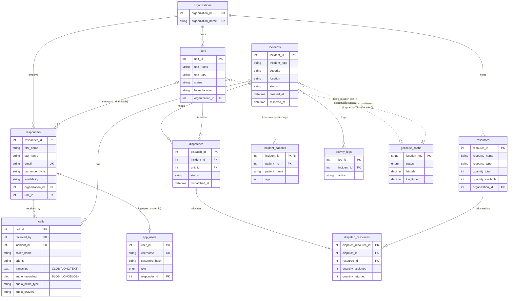

# ER diagram, relational schema and technology justification

Rendered by GitHub / VS Code Mermaid preview. Derived from `emergency_response.sql`, `sql/00`, `sql/01` and `sql/10`.



Constraints beyond the keys (CHECKs, UNIQUE(dispatch, resource), indexes, triggers) are listed in [DATABASE.md](DATABASE.md).

## MongoDB: `recommendation_history`

One document per generated recommendation. It links to MySQL only through integer ids and never copies operational tables.

```json
{
  "recommendation_id": "uuid-hex (unique index)",
  "incident_id": 101,                       // MySQL incidents.incident_id   (index with generated_at)
  "generated_at": "2026-10-27T10:00:00", "generated_by": 2,
  "status": "GENERATED | REVIEWED | SUPERSEDED",   // index with generated_at
  "algorithm_version": "rules-v1", "model": {"llm": null, "llm_enabled": false},
  "ranking": { "candidates": [ {"unit_id": 4, "rank": 1, "score": 0.83, "capability_code": "...", "distance_km": null,
                                "missing": ["..."], "relevant_resources": [ ... ]} ],
               "excluded": [ {"unit_id": 2, "reason_code": "UNIT_BUSY"} ], "weights": {}, "missing": [], "confidence": "MEDIUM" },
  "explanation": null, "explanation_unavailable_reason": "No LLM configured",
  "decision": { "decision": "ACCEPTED", "unit_id": 4, "reason": null, "decided_by": 2, "decided_at": "...", "dispatch_id": 31 },
  "feedback": [ {"rating": 4, "comment": "...", "by": 2, "at": "..."} ]
}
```

Create/Read/Update/Delete: `POST .../recommendations` (create), `GET` (read), `POST .../decision`, `PUT .../dispatch`, `POST .../feedback` (update), `DELETE /recommendations/{id}` (admin).

## MongoDB: `call_transcripts`

One document per call, unique on `call_id` (MySQL `calls.call_id`), written by Groq Whisper (`POST /calls/{id}/transcribe`) or by any other speech-to-text tool that calls the PUT endpoint stored in `calls.audio_recording`:

```json
{ "call_id": 1001, "incident_id": 101, "text": "...", "language": "en", "engine": "stt-model",
  "segments": [ {"start": 0.0, "end": 2.5, "text": "...", "speaker": null} ],
  "audio_sha256": "hash of the audio it was made from", "created_at": "...", "created_by": 2, "updated_at": "..." }
```

Timestamped, variable-length segments per call are why this is a document and not a table; the audio bytes stay in MySQL next to the call they belong to.

## MongoDB: `operational_logs`

One document per logged request (data changes and failed requests; successful reads are skipped). Append-only, expires by TTL index on `ts`.

```json
{ "ts": "2026-10-30T16:01:13", "request_id": "uuid-hex", "level": "INFO | WARNING | ERROR",
  "method": "POST", "path": "/api/calls/1024/transcribe", "route": "/api/calls/{call_id}/transcribe",
  "status": 200, "duration_ms": 812.4, "user_id": 2, "role": "dispatcher", "client_ip": "127.0.0.1" }
```

Append-only events with no relations and a retention policy are a poor fit for relational tables and a good fit for a document store; the per-incident timeline that users see stays in MySQL `activity_logs`.

## Technology justification

| Need | Choice | Why |
|---|---|---|
| Incidents, units, dispatches, resources, users | **MySQL** | Strongly related, shared data that needs foreign keys, CHECK constraints, transactions (allocating stock must not oversell), triggers, stored procedures and column-level privileges. |
| Recommendation records | **MongoDB** | Each record is a self-contained, nested document (ranked candidates with differing evidence fields, reason codes, optional explanation, later decision and feedback). The shape changes whenever a scoring factor is added, and records are read whole by incident, so a document fits better than 5-6 join tables. Losing it never corrupts operations, because MySQL stays authoritative. |
| Operational log | **MongoDB** | High-volume, append-only, schema-light events with automatic expiry; losing them never affects operations. |
| Similar-text search | not used | The rubric asks for "NoSQL/Vector"; MongoDB covers it, so no vector store was added. |
| Cross-database consistency | none (by design) | MySQL and MongoDB writes are separate; failures are reported, not hidden. |
